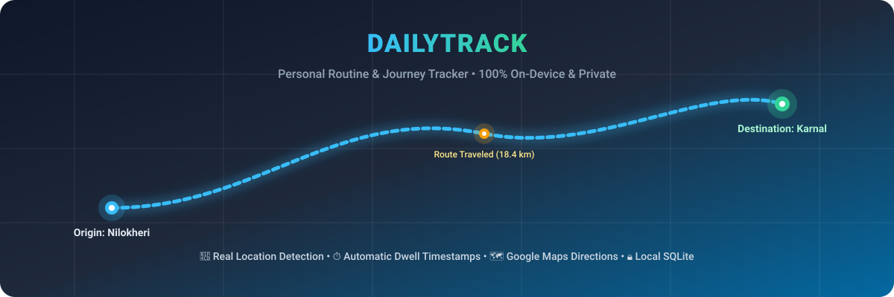
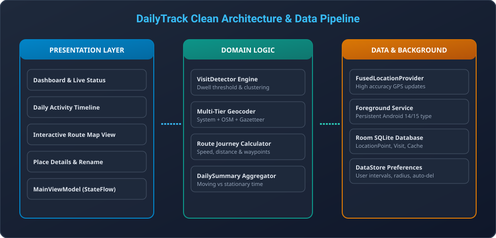

<div align="center">

# DailyTrack – Personal Routine Tracker



[](https://kotlinlang.org)
[](https://developer.android.com)
[](https://developer.android.com/jetpack/compose)
[-orange.svg)](https://developer.android.com/training/data-storage/room)
[](#privacy-guarantee)
[](LICENSE)

**An intelligent, battery-efficient Android application that automatically records your daily movements, places visited, arrival/departure timestamps, and traveling routes — completely offline with zero cloud tracking.**

[Features](#key-features) • [Real-World Example](#real-world-tracking-walkthrough) • [Architecture](#architecture) • [Screenshots & UI](#user-interface-screens) • [Installation](#installation--build)

</div>

---

## 🌟 Key Highlights

- **📍 Real Locality & Place Names**: Multi-tier reverse geocoding engine identifies actual towns, cities, and landmarks (e.g., *Nilokheri*, *Karnal*, *Model Town*) without relying exclusively on fragile cloud APIs.
- **⏱️ Dwell & Stay Duration**: Automatically calculates when you arrive at a place, how long you stay, and when you leave.
- **🚗 Automatic Route Tracking**: Captures continuous GPS paths between consecutive locations with distance, travel time, and average speed.
- **🗺️ 1-Tap Google Maps Directions**: Tap on any recorded journey (e.g., *Nilokheri → Karnal*) to inspect intermediate travel details and launch Google Maps for turn-by-turn navigation.
- **🎨 Interactive Canvas Route Map**: Offline, pinch-to-zoom interactive map displaying visit pins, route polylines, and live location beacons.
- **🔒 100% On-Device Privacy**: No machine learning, no advertising SDKs, and zero telemetry. All data is saved exclusively in local SQLite.

---

## 🗺️ Real-World Tracking Walkthrough

Here is how **DailyTrack** captures an everyday commute (e.g., living in **Nilokheri** and traveling to **Karnal**):

```
┌─────────────────────────────────┐
│ 1. Home Base: Nilokheri         │ ── Arrival: 8:15 AM
│    • Dwell Time: 1 hour 45 mins │    • Status: Stationary
│    • Address: Nilokheri, Karnal │    • Clustered Points: 34
└────────────────┬────────────────┘
                 │
                 ▼ Departure detected (>45m movement threshold)
┌─────────────────────────────────┐
│ 2. Journey: Nilokheri ➔ Karnal   │ ── Distance: 18.4 km
│    • Time: 10:00 AM – 10:28 AM  │    • Duration: 28 mins
│    • Avg Speed: 39.4 km/h       │    • GPS Points: 86
│    • [Open in Google Maps] ───┐ │
└───────────────────────────────┼─┘
                                │ ── Launch Turn-by-Turn Navigation
                                ▼
┌─────────────────────────────────┐
│ 3. Destination: Karnal          │ ── Arrival: 10:28 AM
│    • Dwell Time: 3 hours        │    • Status: Ongoing Visit
│    • Address: Mall Road, Karnal │    • Place Label: Editable
└─────────────────────────────────┘
```

> **Google Maps Integration**: When you tap any journey card in the Timeline, DailyTrack provides complete coordinates, distance metrics, and a direct **"Open in Google Maps"** action with exact origin and destination coordinates.

---

## 🏗️ Architecture

DailyTrack follows **Clean Architecture** principles and the **MVVM (Model-View-ViewModel)** design pattern.



### Layer Breakdown

1. **Presentation Layer (Jetpack Compose & Material 3)**:
   - Single-Activity (`MainActivity`) with type-safe state-driven navigation.
   - Centralized `MyApplicationTheme` with high-contrast, modern M3 dynamic palettes.
   - Custom `InteractiveRouteCanvas` for GPU-accelerated touch/pan/zoom route rendering.

2. **Domain Layer**:
   - `VisitDetector`: Spatial clustering state machine that filters GPS jitter, detects stationary dwelling, and generates visit lifecycle events.
   - `GeocodingService`: Multi-tier geocoder combining Android system geocoding, HTTP reverse lookup fallback, and an offline spatial gazetteer.
   - `DailySummary` & `TimelineItem`: Immutable domain models for daily stats and chronological timeline events.

3. **Data Layer**:
   - `DailyTrackDatabase`: Room SQLite database with tables for `location_points`, `visits`, and `geocode_cache`.
   - `LocationRepository`: Repository handling location ingestion, visit merges, and JSON/CSV exports.
   - `UserPreferencesRepository`: Jetpack DataStore Preferences for update intervals, stationary radius, and auto-deletion schedules.
   - `LocationTrackingService`: Ongoing foreground service with `FOREGROUND_SERVICE_TYPE_LOCATION` notification.

---

## 📱 User Interface Screens

| Screen | Description |
| :--- | :--- |
| **Dashboard** | Real-time tracking status, current location beacon, today's distance, places visited, and time moving vs. stationary. |
| **Daily Timeline** | Chronological feed of visits and travel journeys with date stepper, duration indicators, and Google Maps shortcuts. |
| **Map View** | Fullscreen interactive route visualizer with pinch-to-zoom, visit markers, polyline traces, and center-to-fit controls. |
| **Place Details** | Complete arrival/departure log, GPS accuracy, confidence score, coordinate display, place renaming, and duplicate visit merging. |
| **History & Search** | Search past visits and routines across all dates by place name or street address. |
| **Settings** | GPS frequency presets (5s / 10s / 30s), stationary radius, dwell time threshold, reboot auto-resume, battery guidance, and JSON/CSV data export. |

---

## 🛠️ Technology Stack

- **Language**: Kotlin 2.2.10
- **UI Toolkit**: Jetpack Compose (BOM 2024.09.00) & Material Design 3
- **Architecture**: MVVM + Clean Architecture + Repository Pattern
- **Concurrency**: Kotlin Coroutines & Asynchronous Flow (`StateFlow`)
- **Local Persistence**: Room 2.7.0 with SQLite & Kotlin Symbol Processing (KSP)
- **Preferences**: Jetpack DataStore Preferences 1.1.7
- **Location Services**: Google Play Services Location (`FusedLocationProviderClient`) 21.3.0
- **Background Tasks**: Android Foreground Service & WorkManager 2.10.0
- **Testing**: JUnit 4, Robolectric 4.16.1, AndroidX Test Runner

---

## 🔒 Privacy Guarantee

- **Zero Remote Servers**: DailyTrack does not transmit location data to any cloud service or third party.
- **No Analytics / Ads**: Free from advertising identifiers, trackers, or telemetry SDKs.
- **Data Portability**: You own your data. Export your entire movement history to **CSV** or **JSON** anytime via Android's native share sheet.
- **Data Purge**: Delete individual visits or permanently wipe all recorded tracks with one tap.

---

## ⚙️ Android Compatibility & Permissions

| Permission | Purpose |
| :--- | :--- |
| `ACCESS_FINE_LOCATION` | Required for precise GPS points, visit clusters, and route paths. |
| `ACCESS_COARSE_LOCATION` | Low-power battery-efficient location fallback. |
| `ACCESS_BACKGROUND_LOCATION` | Continues recording routines while device is in pocket or screen is off. |
| `FOREGROUND_SERVICE` | Android system requirement for ongoing background tasks. |
| `FOREGROUND_SERVICE_LOCATION` | Android 14+ (API 34) mandate for background location services. |
| `POST_NOTIFICATIONS` | Android 13+ (API 33) persistent status notification with pause/resume controls. |
| `RECEIVE_BOOT_COMPLETED` | Resumes tracking automatically after a device reboot if enabled. |

---

## 🚀 Installation & Build

### 1. Download Pre-Built APK
The ready-to-install debug APK is available in the repository:
```bash
./final_app/DailyTrack.apk
```
Transfer this file to your Android phone, tap to install, and grant location permissions to begin recording your daily routine.

### 2. Build From Source
Clone the repository and build using Gradle:

```bash
# Clone the repository
git clone https://github.com/your-username/dailytrack.git
cd dailytrack

# Compile and build the Debug APK
gradle :app:assembleDebug

# Run Unit and Robolectric tests
gradle :app:testDebugUnitTest
```

The output APK will be generated at:
```
app/build/outputs/apk/debug/app-debug.apk
```

---

## 📄 License

```
Copyright 2026 DailyTrack Contributors

Licensed under the Apache License, Version 2.0 (the "License");
you may not use this file except in compliance with the License.
You may obtain a copy of the License at

    http://www.apache.org/licenses/LICENSE-2.0

Unless required by applicable law or agreed to in writing, software
distributed under the License is distributed on an "AS IS" BASIS,
WITHOUT WARRANTIES OR CONDITIONS OF ANY KIND, either express or implied.
See the License for the specific language governing permissions and
limitations under the License.
```
